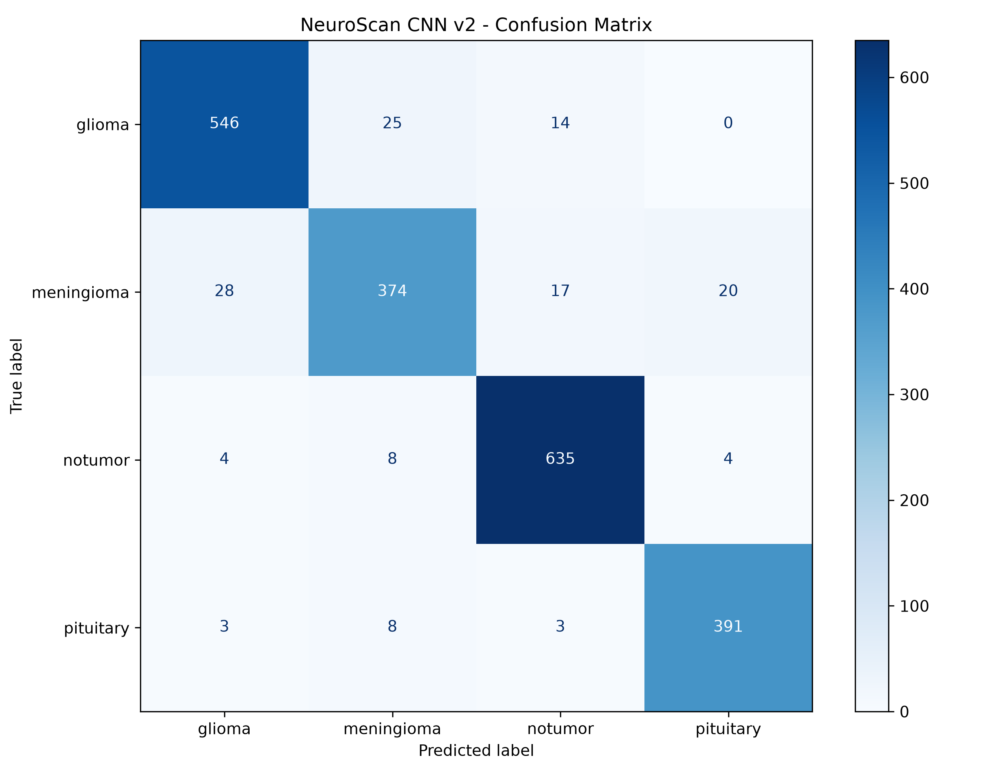
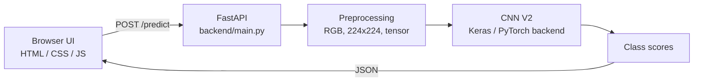

# NeuroScan

**Brain MRI classification with a custom CNN, FastAPI and a JavaScript front end.**

<p align="center">
  
  
  
  
  
</p>

NeuroScan classifies a brain MRI image as **glioma**, **meningioma**, **pituitary tumor** or **no tumor**. It covers the full workflow: data exploration, preprocessing, model development, evaluation, a REST API and a browser interface.

> **Medical disclaimer.** NeuroScan is an educational project. It is not a medical device, has not been clinically validated, and must not be used to diagnose, rule out or make treatment decisions about any condition. MRI scans must be interpreted by qualified healthcare professionals.

**Live demo:** `<add link once deployed>`

<!--  -->

---

## Highlights

- **93.56% test accuracy** and **0.932 macro F1** on 2,080 held-out images
- Custom CNN built from scratch, improved from 86.8% to 93.6% through systematic experiments
- One shared preprocessing pipeline for training, evaluation and inference
- FastAPI `/predict` endpoint and a drag-and-drop web interface
- Full evaluation artifacts: classification report, confusion matrix, training curves

---

## Results

Evaluated on a held-out test set of 2,080 images.

| Metric | Score |
|---|---:|
| Accuracy | **93.56%** |
| Macro precision | 93.31% |
| Macro recall | 93.15% |
| Macro F1 | 93.20% |
| Weighted F1 | 93.51% |

| Class | Precision | Recall | F1 | Images |
|---|---:|---:|---:|---:|
| Glioma | 93.98% | 93.33% | 93.65% | 585 |
| Meningioma | 90.12% | 85.19% | 87.59% | 439 |
| No tumor | 94.92% | 97.54% | 96.21% | 651 |
| Pituitary | 94.22% | 96.54% | 95.37% | 405 |



**Reading the results**
- Meningioma is the weakest class (recall 85.19%). Its errors go mostly to glioma, which is plausible because the two can look similar on MRI.
- 34 of the 1,429 tumor images in the test set (about 2.4%) were predicted as "no tumor". This is the most serious error type for any diagnostic use.
- Training (94.1%), validation (93.9%) and test (93.6%) accuracy are close together, so the model is not overfitting.

These figures describe this dataset split only. They do not show how the model performs on scans from other hospitals, scanners or populations.

Plots and reports are in [`reports/`](reports/).

---

## Model development

| Experiment | Description | Result | Outcome |
|---|---|---:|---|
| CNN V1 | 3 conv layers, no BatchNorm (110k parameters) | 86.78% test | Baseline |
| CNN V1 + BatchNorm | BatchNorm with fixed lr 1e-3 | 83.97% val | Unstable, abandoned |
| EfficientNetB0 | Frozen ImageNet backbone, new head | 84.42% val | Plateaued; frozen features did not fit MRI texture |
| **CNN V2** | 4 blocks, BatchNorm (momentum 0.9), AdamW, cosine lr decay | **93.56% test** | **Selected** |

**What the experiments showed**
- A deeper CNN without BatchNorm reached only about 85%, with training and validation accuracy equal. That is underfitting, so more regularization would not have helped.
- BatchNorm failed the first time because of the learning rate and momentum, not because of the technique. With a lower learning rate (3e-4), a cosine schedule and momentum 0.9, it added about 9 points.
- A frozen pretrained backbone is effectively a linear classifier on ImageNet features. It would need fine-tuning to improve on this task.

### Selected architecture (CNN V2)

```text
Input (224 x 224 x 3)
  -> 4 blocks: [Conv 3x3 -> BatchNorm -> ReLU] x 2 -> MaxPool
     filters: 32 -> 64 -> 128 -> 256
  -> Global Average Pooling
  -> Dense (128, ReLU)
  -> Dropout
  -> Dense (4, Softmax)
```

Training setup: AdamW (weight decay 1e-4), cosine learning-rate decay from 3e-4, BatchNorm momentum 0.9, batch size 32, mixed precision, 15 epochs, best epoch chosen by validation accuracy. Trained on an NVIDIA RTX 3050 (6 GB).

The application loads `models/neuroscan_cnn_v2_bn_final.keras`. Earlier models are kept in `experiments/` to document the development process.

---

## Dataset

[De-duplicated Brain MRI Dataset](https://www.kaggle.com/datasets/faysal202114023/de-duplicated-brain-mri-dataset) on Kaggle (`faysal202114023/de-duplicated-brain-mri-dataset`).

| Split | Images |
|---|---:|
| Training | 15,595 |
| Validation | 3,119 |
| Test | 2,080 |
| **Total** | **20,794** |

Training split class distribution: glioma 4,388, meningioma 3,292, no tumor 4,880, pituitary 3,035.

The dataset is not included in this repository. Download it from its original source and follow its terms of use.

**Preprocessing:** images are converted to RGB, resized to 224 × 224, converted to tensors (pixel values 0-1) and arranged channels-last. Training adds small random rotations (±10°), translations (5%) and scaling (95-105%). Validation, test and inference use the deterministic pipeline only, from the same shared code.

---

## How it works



1. The user selects or drops an MRI image in the browser.
2. JavaScript validates the file and sends it to `/predict`.
3. The backend applies the same preprocessing used for validation and test images.
4. The cached model returns scores for all four classes.
5. The interface shows the predicted class, all scores and a confidence indicator.

---

## Project structure

```text
NeuroScan/
├── backend/
│   ├── __init__.py
│   └── main.py                  # FastAPI app
├── frontend/
│   ├── index.html
│   ├── script.js
│   └── style.css
├── models/
│   └── neuroscan_cnn_v2_bn_final.keras   # model used by the app
├── experiments/
│   ├── cnn_v1/
│   ├── cnn_v2/
│   ├── transfer_learning/       # EfficientNetB0 experiment
│   └── training_history_v2.json
├── reports/                     # curves, confusion matrices, classification report
├── notebook/
│   └── data_exploration.py
├── src/
│   ├── cnn_model.py
│   ├── inference.py
│   └── preprocessing.py
├── train.py
├── evaluate.py
└── requirements.txt
```

---

## Run locally

```bash
git clone https://github.com/ayandabhoya07/NeuroScan.git
cd NeuroScan

# Windows
py -3.11 -m venv .venv
.venv\Scripts\activate

# macOS / Linux
python3.11 -m venv .venv
source .venv/bin/activate

python -m pip install --upgrade pip
pip install -r requirements.txt

python -m uvicorn backend.main:app --reload
```

Open <http://127.0.0.1:8000>. Interactive API docs are at <http://127.0.0.1:8000/docs>.

Make sure `models/neuroscan_cnn_v2_bn_final.keras` exists before starting. The project was developed with Keras 3 on the PyTorch backend and an NVIDIA GPU. CPU-only inference works but is slower, and dependency versions may need adjusting for your system.

**Train and evaluate** (needs the dataset in `brain_mri/{train,val,test}`):

```bash
python train.py
python evaluate.py
```

---

## API

| Method | Endpoint | Description |
|---|---|---|
| GET | `/` | Serves the web interface |
| GET | `/health` | Health check |
| POST | `/predict` | Accepts an image, returns class scores |

```bash
curl -X POST http://127.0.0.1:8000/predict -F "file=@scan.jpg"
```

Response format (illustrative values, not a real prediction):

```json
{
  "predicted_class": "glioma",
  "confidence": 0.94,
  "probabilities": {
    "glioma": 0.94,
    "meningioma": 0.03,
    "notumor": 0.02,
    "pituitary": 0.01
  }
}
```

---

## Limitations

- Educational project; no clinical validation.
- Evaluated on one dataset and one held-out split. Performance on other scanners, hospitals or populations is unknown.
- Meningioma recall (85.19%) is lower than the other classes, and some tumor scans are predicted as "no tumor".
- Softmax scores are not calibrated probabilities and must not be read as medical certainty. The high, moderate and low labels in the interface are display thresholds, not clinical categories.
- Works on single 2D images, not full 3D MRI volumes.

---

## Future work

- Fine-tune EfficientNetB0 and compare it with the custom CNN
- Add Grad-CAM heatmaps to show which regions drive a prediction
- Evaluate on an independent external dataset
- Calibrate confidence scores and analyze meningioma errors in more depth
- Add automated tests for preprocessing, inference and the API
- Add structured experiment tracking and request logging for deployment

---

## Tech stack

Python 3.11 · Keras 3 (PyTorch backend) · PyTorch / torchvision · FastAPI · Uvicorn · Pillow · NumPy · scikit-learn · Matplotlib · HTML / CSS / JavaScript

---

## Acknowledgements

Thanks to the creators of the brain MRI dataset and to the open-source communities behind Keras, PyTorch, FastAPI, NumPy and Pillow.

## Author

**`Ayan`** · [GitHub](https://github.com/ayandabhoya07) · [LinkedIn](` https://www.linkedin.com/in/ayan-dabhoya-3685382aa/`)
